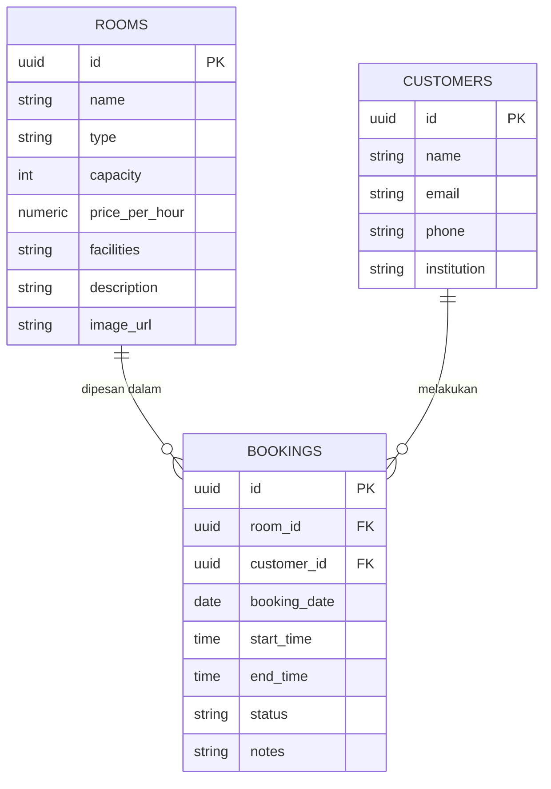

# CoSpace: Sistem Reservasi & Pemantauan Jadwal Coworking Space (PWA)

[](https://cospace-app-umber.vercel.app)
[](https://nodejs.org)
[](https://expressjs.com)
[](https://supabase.com)
[](https://vercel.com)

**CoSpace** adalah Sistem Reservasi dan Pemantauan Jadwal Coworking Space berbasis **Progressive Web App (PWA)** yang dirancang untuk mempermudah pencarian serta pemesanan ruangan kerja (meeting room, private office, dan hot desk) sekaligus memantau jadwal penggunaan ruangan secara real-time. Dibangun secara mobile-first dengan antarmuka yang bersih, intuitif, dan responsif, CoSpace mendukung mode offline penuh dan dapat dipasang (*installable*) langsung pada perangkat desktop maupun ponsel pintar.

---

## 🔗 Tautan Demo & Layanan

- **Demo Aplikasi Frontend**: [https://cospace-app-umber.vercel.app](https://cospace-app-umber.vercel.app)
- **Base URL Backend API**: [https://co-space-indol.vercel.app](https://co-space-indol.vercel.app)

---

## 👤 Identitas Pembuat

- **Nama**: Sandriya Rindy Cahyani
- **NIM**: 21120124120026
- **Tugas**: Tugas Akhir Praktikum Pemrograman Perangkat Bergerak (PPB)

---

## ✨ Fitur-Fitur Utama

1. **Katalog Ruangan**:
   - Menampilkan daftar seluruh ruangan coworking space lengkap dengan gambar visual, tipe ruangan, kapasitas pengguna, tarif per jam, serta fasilitas penunjang.
   - Halaman detail ruangan yang memuat informasi spesifikasi lengkap, deskripsi, dan jadwal reservasi terisi pada ruangan terkait.

2. **Filter & Pencarian**:
   - Pencarian instan ruangan berdasarkan nama ruangan.
   - Filter ruangan berdasarkan chip tipe ruangan (Semua, Meeting Room, Private Office, Hot Desk).

3. **Jadwal Reservasi dengan Status Terkonfirmasi / Selesai Otomatis**:
   - Pemantauan jadwal terorganisir per kelompok tanggal menaik.
   - Penentuan status reservasi secara otomatis di sisi klien:
     - **Terkonfirmasi**: Reservasi aktif yang belum selesai.
     - **Selesai**: Reservasi yang waktu selesainya (`booking_date` + `end_time`) telah terlewati atau berstatus dibatalkan (`cancelled`).
   - Pengecekan ulang otomatis berkala setiap 60 detik (*auto-refresh*) saat halaman dibuka tanpa perlu memuat ulang halaman (*zero reload*).
   - Filter chip jadwal: Semua, Terkonfirmasi, dan Selesai, serta filter tanggal dan dropdown ruangan.

4. **Formulir Reservasi Cerdas dengan Validasi & Cek Bentrok**:
   - Pemilihan ruangan, tanggal, dan rentang jam mulai hingga selesai.
   - Validasi waktu lampau berbasis zona waktu lokal Indonesia (`Asia/Jakarta`, UTC+7) baik di frontend maupun backend.
   - Kalkulasi otomatis total durasi dan estimasi biaya secara dinamis (*live calculation*).
   - Pencegahan bentrok jadwal (*conflict detection*) dengan balasan status HTTP 409 jika waktu yang dipilih telah terisi.

5. **Dialog Konfirmasi Modal**:
   - Review ringkasan lengkap pemesanan sebelum dikirim ke server (ruangan, tanggal, jam mulai-selesai, durasi, estimasi biaya, nama, email, no. telepon, instansi, catatan).
   - Kotak peringatan bahwa reservasi tidak dapat dibatalkan atau diubah setelah dibuat.
   - Proteksi anti klik ganda (*loading state*) saat proses pengiriman ke server.
   - Dialog sukses pemesanan dengan tombol cepat menuju detail reservasi.

6. **Profil Pengguna yang Dapat Diedit**:
   - Penyimpanan data pemesan (nama lengkap, email, nomor telepon, instansi) secara persisten di Local Storage.
   - Kemudahan pengeditan data profil kapan saja dan otomatis terisi (*auto-fill*) pada formulir reservasi.

7. **PWA Installable & Mode Offline**:
   - Dapat diinstal ke homescreen/desktop melalui Web App Manifest.
   - Didukung Service Worker dengan strategi caching berlapis (*Stale-While-Revalidate* untuk aset statis dan *Network-First* untuk endpoint API).
   - Halaman fallback ramah pengguna (`offline.html`) saat koneksi internet terputus.

---

## 🛠️ Tumpukan Teknologi (Tech Stack)

### Frontend
- **Vanilla JavaScript (ES Modules Native)**: Tanpa dependensi framework besar (bebas runtime overhead), SPA berbasis hash routing.
- **HTML5 & CSS3 Modern**: Desain mobile-first, CSS Custom Properties (Variables), Flexbox, CSS Grid, tipografi font Poppins, dan palet warna ungu-biru.
- **PWA Ecosystem**: Service Worker Cache API, Web App Manifest, dan responsive icons.

### Backend
- **Node.js**: Runtime environment JavaScript sisi server (ES Modules).
- **Express.js**: Framework RESTful API yang ringan dan modular.
- **CORS & Dotenv**: Manajemen lintas domain dan konfigurasi variabel lingkungan.

### Database & Deployment
- **Supabase (PostgreSQL)**: Database relasional di awan (cloud database) yang aman dan andal.
- **Vercel**: Platform hosting serverless untuk frontend statis dan backend Node.js.

---

## 📁 Struktur Direktori Proyek

```text
CoSpace/
├── backend/
│   ├── .env.example              # Template konfigurasi variabel lingkungan
│   ├── package.json              # Dependensi dan skrip backend Node.js
│   ├── vercel.json               # Konfigurasi deployment serverless Vercel backend
│   └── src/
│       ├── index.js              # Entry point Express server
│       ├── config/
│       │   └── supabaseClient.js # Inisialisasi koneksi klien Supabase
│       ├── controllers/
│       │   ├── bookingController.js  # Kontroller logika reservasi & cek bentrok
│       │   ├── customerController.js # Kontroller logika data pelanggan
│       │   └── roomController.js     # Kontroller logika data ruangan
│       ├── models/
│       │   ├── bookingModel.js   # Model database tabel bookings
│       │   ├── customerModel.js  # Model database tabel customers
│       │   └── roomModel.js      # Model database tabel rooms
│       └── routes/
│           ├── bookingRoutes.js  # Rute endpoint /api/bookings
│           ├── customerRoutes.js # Rute endpoint /api/customers
│           └── roomRoutes.js     # Rute endpoint /api/rooms
├── frontend/
│   ├── index.html                # Kerangka utama Single Page Application (SPA)
│   ├── manifest.json             # Konfigurasi PWA Web App Manifest
│   ├── offline.html              # Halaman fallback saat offline
│   ├── service-worker.js         # Service Worker untuk caching & offline mode
│   ├── vercel.json               # Konfigurasi header service worker dan manifest
│   ├── css/
│   │   └── style.css             # Seluruh styling aplikasi & tema ungu-biru
│   ├── fonts/
│   │   ├── Poppins-Bold.ttf
│   │   ├── Poppins-Medium.ttf
│   │   ├── Poppins-Regular.ttf
│   │   └── Poppins-SemiBold.ttf
│   ├── icons/
│   │   ├── cospace-logo.svg
│   │   ├── cospace-logo-white.svg
│   │   ├── cospace-mark.svg
│   │   ├── icon-192x192.png
│   │   └── icon-512x512.png
│   ├── images/
│   │   └── rooms/
│   │       ├── creative-room.jpg
│   │       ├── focus-pod.jpg
│   │       ├── hot-desk-area.jpg
│   │       ├── merapi-meeting-room.jpg
│   │       ├── private-office-1.jpg
│   │       ├── private-office-2.jpg
│   │       └── sindoro-meeting-room.jpg
│   └── js/
│       ├── api.js                # Klien HTTP fetcher ke backend API
│       ├── app.js                # Router hash SPA & inisialisasi aplikasi
│       ├── utils.js              # Helper fungsi (waktu, status, rupiah, badge)
│       ├── components/
│       │   └── confirmDialog.js  # Komponen modal konfirmasi & dialog sukses
│       └── pages/
│           ├── bookingDetailPage.js # Halaman Detail Reservasi
│           ├── bookingsPage.js      # Halaman Jadwal Reservasi lengkap
│           ├── bookPage.js          # Halaman Form Pemesanan Ruangan
│           ├── homePage.js          # Halaman Beranda (hero, stat, jadwal hari ini)
│           ├── notFoundPage.js      # Halaman 404 Tidak Ditemukan
│           ├── profilePage.js       # Halaman Profil Pemesan
│           ├── roomDetailPage.js    # Halaman Rincian Ruangan & jadwal terisi
│           └── roomsPage.js         # Halaman Katalog Ruangan & filter
├── .gitignore                    # Berkas yang diabaikan oleh Git
└── README.md                     # Dokumentasi proyek
```

---

## 🗄️ Skema Database (Supabase PostgreSQL)

Aplikasi CoSpace menggunakan 3 tabel utama yang saling berelasi:



### 1. Tabel `rooms`
Menyimpan inventaris data ruangan kerja coworking space.

| Kolom | Tipe Data | Keterangan |
| :--- | :--- | :--- |
| `id` | `UUID` | Primary Key, default `gen_random_uuid()` |
| `name` | `VARCHAR/TEXT` | Nama ruangan (misal: *Focus Pod*, *Merapi Meeting Room*) |
| `type` | `VARCHAR/TEXT` | Tipe ruangan (*Meeting Room*, *Private Office*, *Hot Desk*) |
| `capacity` | `INTEGER` | Kapasitas maksimal pengguna |
| `price_per_hour` | `NUMERIC/INT` | Tarif sewa per jam (Rupiah) |
| `facilities` | `TEXT` | Fasilitas ruangan (teks terpisah koma) |
| `description` | `TEXT` | Deskripsi lengkap mengenai ruangan |
| `image_url` | `TEXT` | URL atau path gambar visual ruangan |

### 2. Tabel `customers`
Menyimpan identitas pelanggan / pemesan ruangan.

| Kolom | Tipe Data | Keterangan |
| :--- | :--- | :--- |
| `id` | `UUID` | Primary Key, default `gen_random_uuid()` |
| `name` | `VARCHAR/TEXT` | Nama lengkap pemesan |
| `email` | `VARCHAR/TEXT` | Alamat email unik pemesan |
| `phone` | `VARCHAR/TEXT` | Nomor telepon pemesan |
| `institution` | `VARCHAR/TEXT` | Nama instansi / perusahaan pemesan (opsional) |

### 3. Tabel `bookings`
Menyimpan transaksi reservasi dan jadwal pemakaian ruangan.

| Kolom | Tipe Data | Keterangan |
| :--- | :--- | :--- |
| `id` | `UUID` | Primary Key, default `gen_random_uuid()` |
| `room_id` | `UUID` | Foreign Key mengacu ke `rooms(id)` |
| `customer_id` | `UUID` | Foreign Key mengacu ke `customers(id)` |
| `booking_date` | `DATE` | Tanggal reservasi (`YYYY-MM-DD`) |
| `start_time` | `TIME` | Waktu mulai pemakaian (`HH:mm:ss`) |
| `end_time` | `TIME` | Waktu selesai pemakaian (`HH:mm:ss`) |
| `status` | `VARCHAR/TEXT` | Status pemesanan (`confirmed`, `cancelled`, dll) |
| `notes` | `TEXT` | Catatan kebutuhan khusus dari pemesan (opsional) |

---

## 📡 Daftar Endpoint API Backend

Base URL lokal: `http://localhost:3000`  
Base URL cloud: `https://co-space-indol.vercel.app`

### 1. General
| Method | Path | Deskripsi |
| :--- | :--- | :--- |
| `GET` | `/` | Health check status server API |

### 2. Ruangan (`/api/rooms`)
| Method | Path | Deskripsi |
| :--- | :--- | :--- |
| `GET` | `/api/rooms` | Mengambil seluruh katalog data ruangan (urut nama) |
| `GET` | `/api/rooms/:id` | Mengambil rincian detail satu ruangan berdasarkan ID |
| `GET` | `/api/rooms/:id/bookings` | Mengambil jadwal reservasi terisi pada ruangan tertentu |
| `POST` | `/api/rooms` | Menambahkan data ruangan baru |
| `PUT` | `/api/rooms/:id` | Memperbarui data ruangan berdasarkan ID |
| `DELETE` | `/api/rooms/:id` | Menghapus ruangan berdasarkan ID |

### 3. Pelanggan (`/api/customers`)
| Method | Path | Deskripsi |
| :--- | :--- | :--- |
| `GET` | `/api/customers` | Mengambil daftar seluruh data pelanggan |
| `GET` | `/api/customers/:id` | Mengambil data pelanggan berdasarkan ID |
| `POST` | `/api/customers` | Menambahkan pelanggan baru |
| `PUT` | `/api/customers/:id` | Memperbarui data pelanggan berdasarkan ID |
| `DELETE` | `/api/customers/:id` | Menghapus data pelanggan berdasarkan ID |

### 4. Reservasi (`/api/bookings`)
| Method | Path | Deskripsi |
| :--- | :--- | :--- |
| `GET` | `/api/bookings` | Mengambil semua reservasi (filter opsional: `?date=`, `?status=`, `?room_id=`) |
| `GET` | `/api/bookings/:id` | Mengambil detail reservasi lengkap beserta relasi `rooms` & `customers` |
| `POST` | `/api/bookings` | Membuat reservasi baru (dengan validasi jam lampau UTC+7 & proteksi bentrok jadwal) |
| `PUT` | `/api/bookings/:id` | Memperbarui reservasi (dengan validasi bentrok jadwal baru) |
| `DELETE` | `/api/bookings/:id` | Menghapus data reservasi berdasarkan ID |

---

## 🚀 Panduan Menjalankan Proyek Secara Lokal

### Prasyarat Sistem
- **Node.js** versi 18.0.0 atau yang lebih baru ([Unduh Node.js](https://nodejs.org/))
- **NPM** (terpasang otomatis bersama Node.js)
- Akun dan project aktif di **[Supabase](https://supabase.com/)**

---

### Langkah 1: Kloning Repositori
```bash
git clone https://github.com/Sandriyarc/CoSpace.git
cd CoSpace
```

---

### Langkah 2: Menjalankan Backend API

1. Buka terminal dan masuk ke direktori `backend`:
   ```bash
   cd backend
   ```

2. Pasang dependensi yang diperlukan:
   ```bash
   npm install
   ```

3. Buat file `.env` berdasarkan template `.env.example`:
   ```bash
   cp .env.example .env
   ```

4. Buka file `.env` dan isi dengan kredensial Supabase Anda:
   ```env
   SUPABASE_URL=https://proyek-anda.supabase.co
   SUPABASE_KEY=anon-key-rahasia-anda
   PORT=3000
   ```

5. Jalankan server backend:
   - Mode Pengembangan (Hot Reload dengan Nodemon):
     ```bash
     npm run dev
     ```
   - Mode Standar / Produksi:
     ```bash
     npm start
     ```

   Server backend akan aktif di `http://localhost:3000`.

---

### Langkah 3: Menjalankan Frontend

Aplikasi frontend CoSpace menggunakan arsitektur Vanilla JavaScript dengan **ES Modules native** (`import`/`export`), sehingga membutuhkan web server lokal (tidak dapat dibuka dengan klik ganda file protokol `file:///`).

1. Buka terminal baru dan masuk ke direktori `frontend`:
   ```bash
   cd frontend
   ```

2. Jalankan server lokal statis (pilih salah satu opsi berikut):

   - **Opsi A — Menggunakan Node.js `npx serve` (Direkomendasikan)**:
     ```bash
     npx serve .
     ```
   - **Opsi B — Menggunakan Python HTTP Server**:
     ```bash
     # Python 3
     python -m http.server 8080
     ```
   - **Opsi C — Menggunakan Ekstensi VS Code**:
     Buka folder proyek di VS Code, klik kanan pada `frontend/index.html`, lalu pilih **"Open with Live Server"**.

3. Buka peramban (browser) dan akses URL yang ditampilkan (contoh: `http://localhost:3000` atau `http://localhost:8080`).

---

## 📱 PWA & Pemasangan Aplikasi

1. **Desktop (Google Chrome / Microsoft Edge)**:
   - Kunjungi aplikasi di browser.
   - Klik ikon instal di sisi kanan address bar atau klik tombol **"Pasang Aplikasi"** pada menu sidebar desktop.
2. **Mobile (Android Chrome)**:
   - Akses aplikasi, lalu klik banner instal atau pilih menu titik tiga browser > **"Add to Home screen" / "Tambahkan ke Layar Utama"**.
3. **Mobile (iOS Safari)**:
   - Akses aplikasi di Safari, klik tombol **Bagikan (Share)** > pilih **"Add to Home Screen"**.
4. **Dukungan Offline**:
   - Berkat Service Worker, halaman yang telah dibuka sebelumnya akan tetap dapat diakses meskipun perangkat kehilangan sinyal internet. Jika membuka halaman baru yang belum tercache saat offline, aplikasi akan otomatis menampilkan halaman ramah pengguna `offline.html`.

---

## 📄 Lisensi

Proyek ini dikembangkan untuk tujuan akademis Tugas Akhir Praktikum Pemrograman Perangkat Bergerak (PPB) Departemen Teknik Komputer, Universitas Diponegoro.
